# AulaFix ULEAM

## Guía completa del proyecto, funcionamiento y defensa

---

# 1. Introducción

**AulaFix ULEAM** es un sistema web para gestionar incidencias de mantenimiento dentro de la universidad.

El sistema permite registrar problemas relacionados con:

- equipos tecnológicos;
- electricidad;
- climatización;
- mobiliario;
- internet y red;
- limpieza;
- infraestructura;
- otras incidencias.

AulaFix permite controlar todo el proceso desde que un usuario registra una incidencia hasta que esta es solucionada y cerrada.

El sistema trabaja con tres roles principales:

- Usuario
- Técnico
- Administrador

Cada rol posee diferentes permisos y responsabilidades.

---

# 2. Objetivo general

Desarrollar un sistema web que permita registrar, administrar, asignar, atender y cerrar incidencias de mantenimiento dentro de la universidad, manteniendo trazabilidad mediante estados, historial, comentarios, evidencias, notificaciones, tickets y métricas.

---

# 3. Objetivos específicos

1. Permitir a los usuarios registrar incidencias.
2. Generar un ticket único para cada reporte.
3. Asignar tiempos máximos de atención mediante SLA.
4. Permitir al administrador revisar incidencias.
5. Asignar técnicos responsables.
6. Permitir al técnico registrar el trabajo realizado.
7. Guardar evidencia inicial y final.
8. Registrar historial de cambios.
9. Permitir comentarios.
10. Generar notificaciones automáticas.
11. Aplicar reglas de seguridad según el rol.
12. Mostrar estadísticas mediante un dashboard.

---

# 4. Arquitectura general

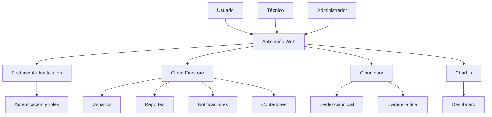

---

# 5. Tecnologías utilizadas

## HTML

HTML se utiliza para construir la estructura de las páginas del sistema.

Entre las principales páginas se encuentran:

```text
mis-reportes.html
nuevo-reporte.html
reporte-detalle.html
notificaciones.html
tecnico/tareas.html
admin/dashboard.html
admin/reportes.html
admin/usuarios.html
```

---

## CSS

CSS se utiliza para controlar:

- diseño;
- colores;
- tarjetas;
- botones;
- formularios;
- badges;
- tablas;
- distribución visual.

El archivo principal es:

```text
public/css/style.css
```

---

## JavaScript

JavaScript controla la lógica principal del sistema.

Entre sus funciones están:

- autenticación;
- validaciones;
- lectura de Firestore;
- escritura en Firestore;
- tickets;
- SLA;
- estados;
- comentarios;
- técnicos;
- usuarios;
- notificaciones;
- imágenes;
- dashboard.

---

# 6. Firebase Authentication

Firebase Authentication se utiliza para iniciar sesión mediante correo electrónico y contraseña.

Cada usuario autenticado posee un identificador único:

```text
UID
```

Ese UID se relaciona con el documento correspondiente dentro de:

```text
usuarios
```

---

# 7. Cloud Firestore

Cloud Firestore es la base de datos principal de AulaFix.

Las colecciones principales son:

```text
usuarios
reportes
notificaciones
contadores
```

---

# 8. Cloudinary

Cloudinary se utiliza para almacenar fotografías.

El sistema maneja:

```text
Evidencia inicial
Evidencia final
```

Firestore no guarda directamente la imagen.

Guarda la URL generada por Cloudinary.

---

# 9. Chart.js

Chart.js se utiliza para generar los gráficos del dashboard administrativo.

Actualmente permite visualizar:

```text
Reportes por estado
Reportes por prioridad
```

---

# 10. Roles del sistema

## Usuario

El usuario puede:

- iniciar sesión;
- crear reportes;
- consultar sus reportes;
- ver el detalle;
- agregar comentarios;
- consultar ticket;
- consultar SLA;
- recibir notificaciones.

---

## Técnico

El técnico puede:

- consultar tareas asignadas;
- iniciar el trabajo;
- cambiar el estado a `en_proceso`;
- registrar la solución;
- subir evidencia final;
- marcar el reporte como `solucionado`;
- recibir notificaciones.

---

## Administrador

El administrador puede:

- consultar todos los reportes;
- revisar incidencias;
- asignar técnicos;
- rechazar reportes;
- cerrar reportes;
- reabrir incidencias;
- administrar usuarios;
- cambiar roles;
- activar o desactivar usuarios;
- consultar estadísticas;
- revisar métricas;
- recibir notificaciones.

---

# 11. Flujo de estados

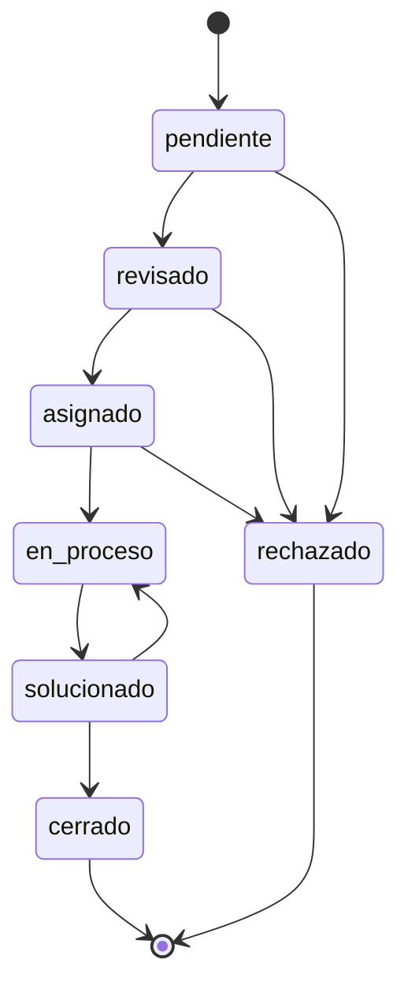

---

# 12. Estado pendiente

Cuando un usuario crea un reporte, el estado inicial es:

```text
pendiente
```

Esto significa que todavía no ha sido revisado por el administrador.

---

# 13. Estado revisado

El administrador revisa la incidencia.

La transición es:

```text
pendiente
↓
revisado
```

---

# 14. Estado asignado

Después de revisar el reporte, el administrador selecciona un técnico.

```text
revisado
↓
asignado
```

El reporte guarda:

```text
tecnico_id
tecnico_nombre
```

---

# 15. Estado en_proceso

El técnico comienza a trabajar.

```text
asignado
↓
en_proceso
```

El usuario recibe una notificación indicando que su incidencia está siendo atendida.

---

# 16. Estado solucionado

Cuando el técnico termina:

```text
en_proceso
↓
solucionado
```

Para finalizar el trabajo se registra evidencia final.

---

# 17. Estado cerrado

El administrador valida la solución.

```text
solucionado
↓
cerrado
```

Este estado representa la finalización oficial de la incidencia.

---

# 18. Estado rechazado

Un administrador puede rechazar una incidencia desde:

```text
pendiente
revisado
asignado
```

El usuario recibe una notificación con el motivo.

---

# 19. Reapertura

Un reporte solucionado puede reabrirse.

```text
solucionado
↓
en_proceso
```

Esto permite volver a trabajar sobre una incidencia si la solución necesita revisión.

---

# 20. Flujo por roles

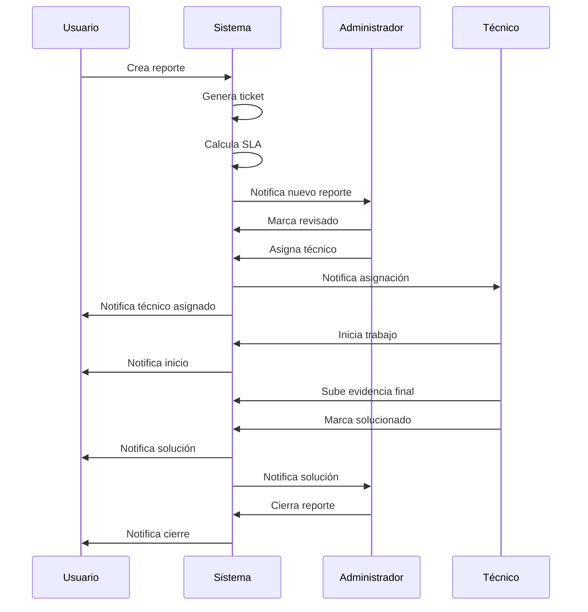

---

# 21. Estructura de Firestore

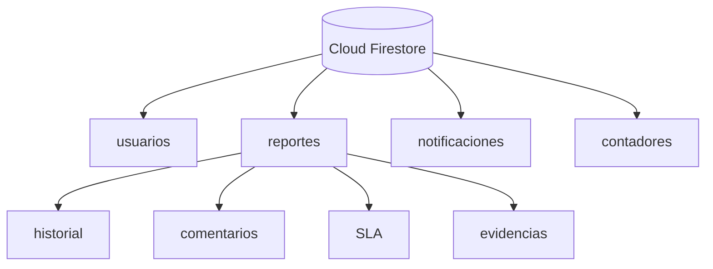

---

# 22. Colección usuarios

Ejemplo conceptual:

```json
{
  "uid": "UID_USUARIO",
  "nombre": "Pablo Cevallos",
  "email": "correo@ejemplo.com",
  "rol": "usuario",
  "activo": true
}
```

Los roles disponibles son:

```text
usuario
tecnico
administrador
```

---

# 23. Colección reportes

Cada reporte puede contener:

```text
ticket
titulo
categoria
prioridad
descripcion
ubicacion
imagen_inicial_url
evidencia_final_url
creado_por
creado_por_nombre
estado
tecnico_id
tecnico_nombre
sla_horas
vence_en
creado_en
actualizado_en
historial
comentarios
```

---

# 24. Modelo conceptual

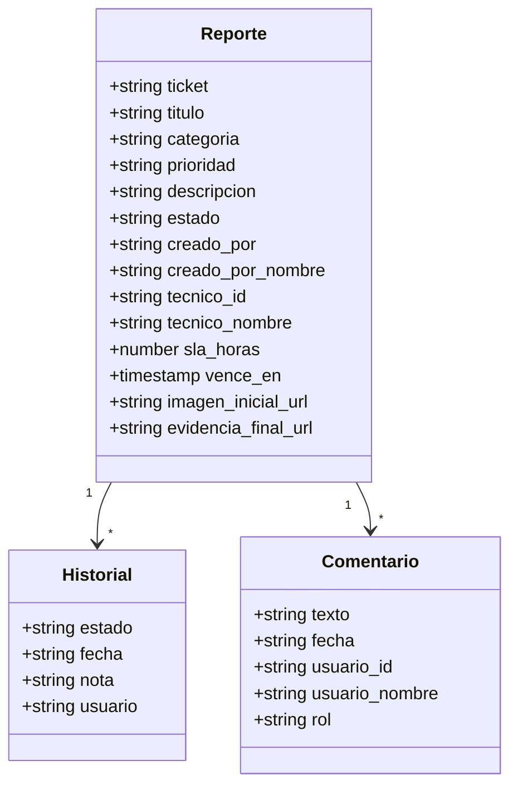

---

# 25. Tickets secuenciales

Cada nuevo reporte recibe un ticket.

Formato:

```text
AF-2026-0001
AF-2026-0002
AF-2026-0003
```

Significado:

```text
AF
=
AulaFix

2026
=
Año

0001
=
Número secuencial
```

---

# 26. Contadores de tickets

Firestore utiliza:

```text
contadores
```

Ejemplo:

```text
contadores
└── tickets-2026
```

Contenido conceptual:

```json
{
  "anio": 2026,
  "secuencia": 3
}
```

El siguiente reporte genera:

```text
AF-2026-0004
```

---

# 27. Transacciones de Firestore

La generación del ticket utiliza una transacción.

Esto permite evitar que dos reportes reciban el mismo número.

Flujo:

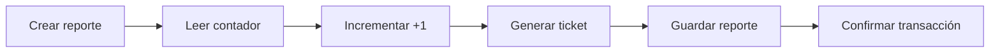

---

# 28. SLA

SLA significa:

```text
Service Level Agreement
```

En AulaFix representa el tiempo máximo esperado de atención según la prioridad.

---

# 29. SLA por prioridad

| Prioridad | SLA |
|---|---:|
| Urgente | 2 horas |
| Alta | 6 horas |
| Media | 24 horas |
| Baja | 72 horas |

---

# 30. Cálculo de vencimiento

El cálculo es:

```text
Fecha de creación
+
Horas SLA
=
Fecha de vencimiento
```

Ejemplo:

```text
Creación:
15/11/2026 10:00

Prioridad:
Alta

SLA:
6 horas

Vencimiento:
15/11/2026 16:00
```

---

# 31. Estados del SLA

El sistema puede mostrar:

```text
A TIEMPO
PRÓXIMO A VENCER
VENCIDO
CUMPLIDO
FUERA DE SLA
SIN SLA
RECHAZADO
```

---

# 32. A TIEMPO

Significa que el reporte sigue activo y todavía no ha alcanzado la fecha límite.

---

# 33. PRÓXIMO A VENCER

Aparece cuando falta una hora o menos para alcanzar el vencimiento.

---

# 34. VENCIDO

El reporte sigue activo pero ya superó el tiempo permitido por SLA.

---

# 35. CUMPLIDO

El técnico solucionó el reporte antes o exactamente en la fecha límite.

```text
fecha solución <= fecha límite
```

Resultado:

```text
CUMPLIDO
```

---

# 36. FUERA DE SLA

El reporte fue solucionado después de la fecha límite.

```text
fecha solución > fecha límite
```

Resultado:

```text
FUERA DE SLA
```

---

# 37. SIN SLA

Este estado puede aparecer en reportes antiguos creados antes de implementar el SLA.

---

# 38. Notificaciones

El sistema cuenta con notificaciones automáticas.

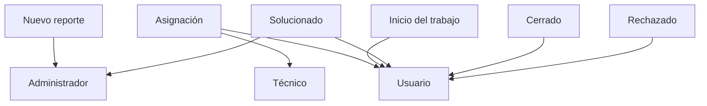

---

# 39. Campana de notificaciones

Las páginas principales muestran una campana:

```text
🔔
```

Si existen notificaciones no leídas:

```text
🔔 3
```

El contador se actualiza mediante Firestore.

---

# 40. Página de notificaciones

La página permite:

- ver todas;
- ver no leídas;
- ver leídas;
- marcar una como leída;
- marcar todas como leídas;
- abrir el reporte relacionado.

---

# 41. Evidencia inicial

La evidencia inicial puede ser subida por el usuario al crear un reporte.

Es opcional.

---

# 42. Evidencia final

La evidencia final se utiliza para demostrar la solución realizada.

El técnico la carga al marcar:

```text
solucionado
```

---

# 43. Cloudinary

El flujo de imágenes es:

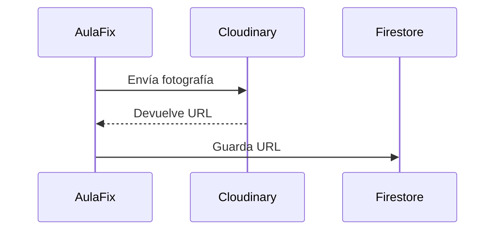

---

# 44. Historial

Cada reporte mantiene un historial.

Ejemplo:

```text
pendiente
revisado
asignado
en_proceso
solucionado
cerrado
```

Cada entrada puede almacenar:

```text
estado
fecha
nota
usuario
```

---

# 45. Comentarios

Cada reporte puede almacenar comentarios.

Un comentario contiene:

```text
texto
fecha
usuario_id
usuario_nombre
rol
```

---

# 46. Seguridad

La seguridad utiliza tres elementos:

```text
Firebase Authentication
+
Roles
+
Firestore Rules
```

---

# 47. Seguridad del usuario

El usuario puede:

- crear sus reportes;
- consultar sus reportes;
- agregar comentarios;
- ver sus notificaciones.

No puede:

- asignarse técnicos;
- cambiar tickets;
- cambiar SLA;
- cerrar incidencias;
- modificar reportes de otros usuarios.

---

# 48. Seguridad del técnico

El técnico puede trabajar únicamente sobre reportes asignados a su UID.

Transiciones permitidas:

```text
asignado
→
en_proceso
```

```text
en_proceso
→
solucionado
```

No debe modificar:

```text
ticket
prioridad
creador
SLA
tecnico_id
tecnico_nombre
```

---

# 49. Seguridad del administrador

El administrador puede:

- gestionar reportes;
- asignar técnicos;
- cerrar;
- rechazar;
- reabrir;
- gestionar usuarios;
- cambiar roles;
- consultar estadísticas.

---

# 50. Dashboard

El dashboard pertenece al administrador.

Muestra:

```text
Total
Pendientes
En proceso
Solucionados
Cerrados
Vencidos / fuera de SLA
Cumplimiento SLA
Tiempo promedio
Técnicos con tareas activas
```

---

# 51. Cumplimiento SLA

Ejemplo:

```text
3 reportes evaluados

1 cumple
2 incumplen
```

Cálculo:

```text
1 / 3 × 100
=
33 %
```

---

# 52. Técnicos con tareas activas

Esta métrica cuenta técnicos, no reportes.

Solo se consideran:

```text
asignado
en_proceso
```

Ejemplo:

```text
Tren tiene 4 reportes históricos.

Solo 1 está activo.

Técnicos con tareas activas:
1
```

---

# 53. Rendimiento de técnicos

Se pueden mostrar:

```text
Asignados
Activos
Solucionados
Cerrados
Tiempo promedio
```

Ejemplo:

| Técnico | Asignados | Activos | Solucionados | Cerrados | Tiempo promedio |
|---|---:|---:|---:|---:|---|
| Tren Cevallos | 4 | 1 | 2 | 1 | 5 min |

---

# 54. Reportes por estado

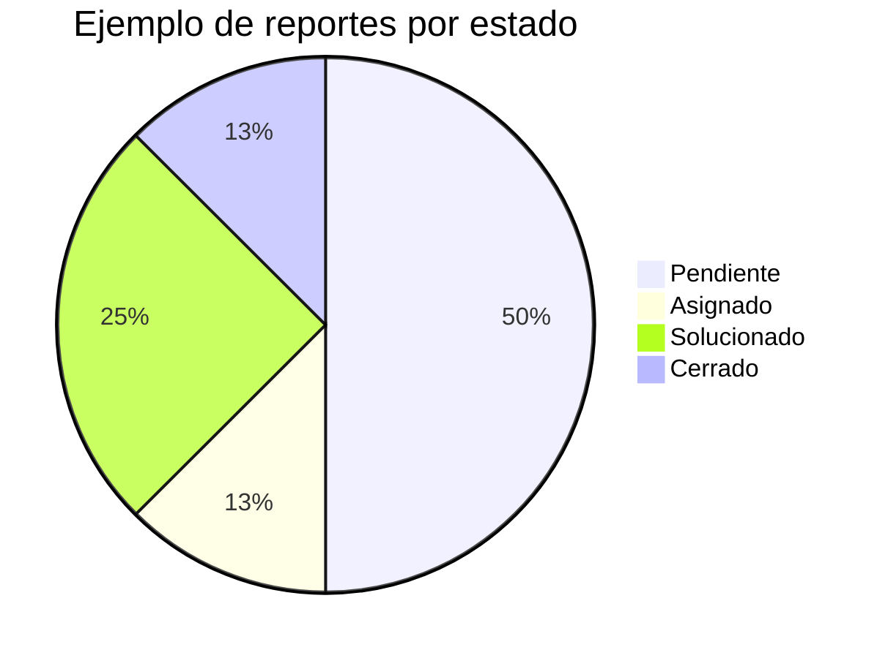

---

# 55. Reportes por prioridad

```mermaid
xychart-beta

    title "Ejemplo de reportes por prioridad"

    x-axis [
        "Baja",
        "Media",
        "Alta",
        "Urgente"
    ]

    y-axis "Cantidad" 0 --> 5

    bar [0, 3, 4, 1]
```

---

# 56. Páginas del usuario

```text
mis-reportes.html
nuevo-reporte.html
reporte-detalle.html
notificaciones.html
```

---

# 57. Páginas del técnico

```text
tecnico/tareas.html
notificaciones.html
```

---

# 58. Páginas del administrador

```text
admin/dashboard.html
admin/reportes.html
admin/usuarios.html
notificaciones.html
```

---

# 59. Archivos JavaScript

Los principales son:

```text
firebase-config.js
cloudinary-config.js
upload.js
auth.js
db.js
notifications-ui.js
```

---

# 60. firebase-config.js

Inicializa Firebase.

---

# 61. cloudinary-config.js

Contiene la configuración necesaria para la subida de imágenes a Cloudinary.

---

# 62. upload.js

Contiene la lógica para subir las evidencias.

---

# 63. auth.js

Controla:

- autenticación;
- sesión;
- perfil;
- roles;
- protección de páginas.

---

# 64. db.js

Es uno de los archivos centrales.

Gestiona:

```text
reportes
usuarios
técnicos
tickets
SLA
estados
historial
comentarios
notificaciones
```

---

# 65. notifications-ui.js

Controla:

```text
campana
contador de no leídas
actualización en tiempo real
```

---

# 66. Flujo completo para demostración

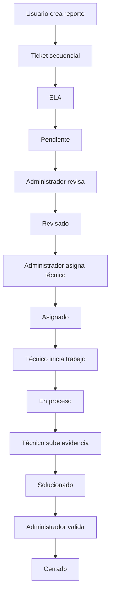

---

# 67. Demostración recomendada

## Usuario

1. Iniciar sesión.
2. Crear un reporte.
3. Mostrar ticket.
4. Mostrar prioridad.
5. Mostrar SLA.
6. Mostrar vencimiento.

---

## Administrador

1. Entrar al dashboard.
2. Mostrar notificación.
3. Abrir reportes.
4. Marcar como revisado.
5. Seleccionar técnico.
6. Asignarlo.

---

## Técnico

1. Iniciar sesión.
2. Abrir Mis tareas.
3. Ver reporte asignado.
4. Pulsar Iniciar trabajo.
5. Mostrar estado `en_proceso`.
6. Marcar solucionado.
7. Subir evidencia final.

---

## Administrador nuevamente

1. Revisar notificación.
2. Abrir reporte solucionado.
3. Revisar evidencia.
4. Cerrar reporte.

---

## Dashboard

Mostrar:

- métricas;
- SLA;
- gráficos;
- categorías;
- técnicos;
- tiempo promedio;
- reportes recientes.

---

# 68. Pregunta: ¿Qué problema resuelve AulaFix?

AulaFix permite centralizar la gestión de incidencias de mantenimiento dentro de la universidad.

Permite saber:

- quién reportó;
- qué problema ocurrió;
- dónde ocurrió;
- quién debe atenderlo;
- en qué estado se encuentra;
- cuánto tiempo tiene para solucionarse;
- cuándo fue solucionado.

---

# 69. Pregunta: ¿Por qué existen tres roles?

Porque cada participante tiene responsabilidades diferentes.

```text
Usuario
→ Reporta

Administrador
→ Gestiona

Técnico
→ Soluciona
```

---

# 70. Pregunta: ¿Por qué Firebase?

Firebase facilita la integración de:

```text
Authentication
Firestore
Hosting
Reglas de seguridad
```

con una aplicación web.

---

# 71. Pregunta: ¿Por qué Firestore?

Porque permite:

- documentos;
- colecciones;
- consultas;
- seguridad;
- datos en tiempo real;
- integración directa con JavaScript.

---

# 72. Pregunta: ¿Por qué Cloudinary?

Porque permite almacenar las imágenes fuera de Firestore.

Firestore solamente guarda la URL.

---

# 73. Pregunta: ¿Qué es SLA?

SLA significa:

```text
Service Level Agreement
```

Representa el tiempo máximo esperado para atender una incidencia.

---

# 74. Pregunta: ¿Cómo se calcula?

Ejemplo:

```text
Fecha:
10:00

Prioridad alta:
6 horas

Vence:
16:00
```

---

# 75. Pregunta: ¿Cómo saben si se cumplió?

Se compara:

```text
Fecha de solución
vs
Fecha límite
```

Si:

```text
solución <= límite
```

Resultado:

```text
CUMPLIDO
```

Si:

```text
solución > límite
```

Resultado:

```text
FUERA DE SLA
```

---

# 76. Pregunta: ¿Cómo evitan tickets duplicados?

Mediante:

```text
Transacción de Firestore
+
Contador anual
```

---

# 77. Pregunta: ¿Qué pasa si dos personas reportan al mismo tiempo?

Firestore controla la transacción.

De esta forma se evita que ambos reportes reciban el mismo número secuencial.

---

# 78. Pregunta: ¿Qué diferencia existe entre solucionado y cerrado?

## Solucionado

El técnico indica que terminó el trabajo.

## Cerrado

El administrador confirma que la incidencia puede finalizar.

---

# 79. Pregunta: ¿Por qué se puede reabrir?

Porque una incidencia que parecía solucionada podría requerir trabajo adicional.

```text
solucionado
→
en_proceso
```

---

# 80. Pregunta: ¿Cómo funciona la seguridad?

Mediante:

```text
Firebase Authentication
+
roles
+
Firestore Rules
```

---

# 81. Pregunta: ¿Puede el técnico modificar cualquier reporte?

No.

El sistema verifica que:

```text
reporte.tecnico_id
==
UID del técnico autenticado
```

---

# 82. Pregunta: ¿Qué registra el historial?

El historial mantiene:

```text
estado
fecha
usuario
nota
```

Esto permite trazabilidad.

---

# 83. Pregunta: ¿Para qué sirven los comentarios?

Permiten registrar observaciones durante el ciclo de atención de una incidencia.

---

# 84. Pregunta: ¿Para qué sirve el dashboard?

Permite al administrador analizar el funcionamiento del sistema.

Muestra:

- cantidad de incidencias;
- estados;
- prioridades;
- cumplimiento;
- rendimiento;
- tiempos;
- técnicos activos.

---

# 85. Fortalezas de AulaFix

1. Sistema por roles.
2. Flujo completo.
3. Tickets secuenciales.
4. SLA.
5. Evidencia inicial.
6. Evidencia final.
7. Historial.
8. Comentarios.
9. Notificaciones.
10. Seguridad.
11. Dashboard.
12. Métricas.
13. Gráficos.
14. Trazabilidad.
15. Control de técnicos.

---

# 86. Explicación corta para iniciar la exposición

> AulaFix ULEAM es un sistema web diseñado para gestionar incidencias de mantenimiento dentro de la universidad. El sistema cuenta con tres roles principales: usuario, técnico y administrador. El usuario registra el problema, el administrador lo revisa y asigna un técnico y posteriormente el técnico atiende la incidencia y registra evidencia de la solución. Finalmente, el administrador puede cerrar el reporte. El sistema además incorpora tickets secuenciales, SLA según prioridad, notificaciones, historial, comentarios, seguridad y un dashboard de estadísticas.

---

# 87. Explicación técnica corta

> AulaFix fue desarrollado utilizando HTML, CSS y JavaScript. Firebase Authentication controla el acceso, Cloud Firestore almacena la información del sistema y aplica reglas de seguridad, Cloudinary almacena las evidencias fotográficas y Chart.js genera las estadísticas visuales del dashboard. Los tickets son generados mediante una transacción de Firestore con un contador anual para evitar duplicados.

---

# 88. Resumen rápido para memorizar

```text
AulaFix
=
Sistema de incidencias

Roles
=
Usuario
Técnico
Administrador

Flujo
=
pendiente
revisado
asignado
en_proceso
solucionado
cerrado

Rechazo
=
pendiente / revisado / asignado
→ rechazado

Firebase
=
Authentication
Firestore
Hosting

Cloudinary
=
Evidencias

Chart.js
=
Dashboard

Ticket
=
AF-2026-0001

SLA
=
Urgente 2h
Alta 6h
Media 24h
Baja 72h

Seguridad
=
Authentication
+
roles
+
Firestore Rules

Objetivo
=
Control
Seguimiento
Trazabilidad
```

---

# 89. Conclusión

AulaFix ULEAM permite administrar el ciclo completo de una incidencia de mantenimiento.

No solamente registra un problema.

También permite:

- identificar al usuario;
- identificar la ubicación;
- determinar prioridad;
- calcular SLA;
- asignar técnico;
- controlar estados;
- guardar evidencias;
- almacenar comentarios;
- registrar historial;
- generar notificaciones;
- medir resultados.

Esto permite mantener una trazabilidad completa desde la creación hasta el cierre de la incidencia.

---

# 90. Flujo final resumido

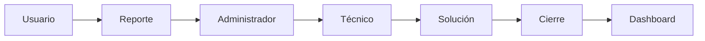

---

# Fin

**Proyecto: AulaFix ULEAM**

**Sistema web de gestión de incidencias universitarias**